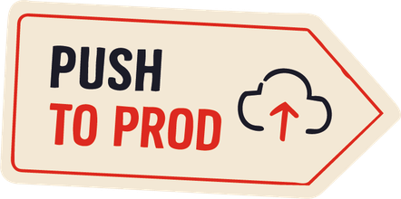
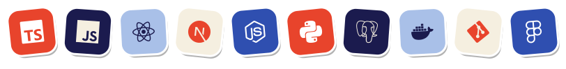
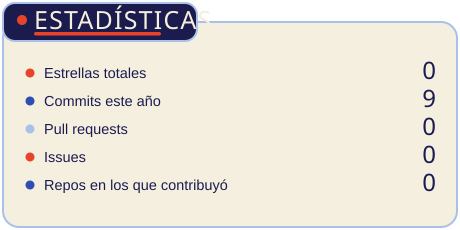
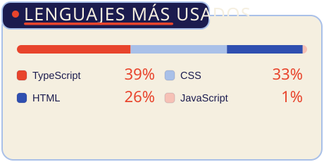
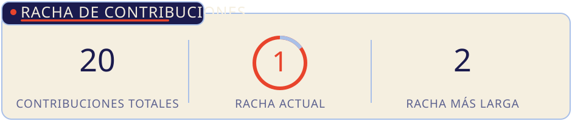
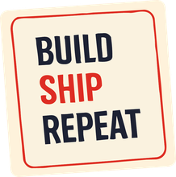

  

<!-- EDITA: cambia los enlaces TU_USUARIO / TU_CANAL y la URL del portfolio por los tuyos -->

  
  
  
  
  

Desarrollador **fullstack**, **AI engineer** y creador de contenido sobre tecnología.

Comparto rutas de estudio, consejos prácticos y lo que aprendo construyendo software real, para que más personas puedan entrar y crecer en este mundo.

**En qué estoy**

- Construyendo productos con IA de punta a punta.
- Creando rutas de estudio para quien empieza en desarrollo de software.
- Abierto a colaborar en proyectos tecnológicos: **hanssabalza1@gmail.com**

 

  

<!-- Las tarjetas se regeneran solas cada día con .github/workflows/stats.yml -->

  
  

  

  

